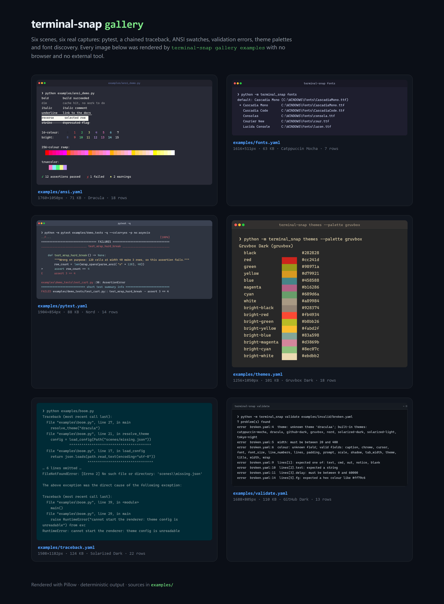
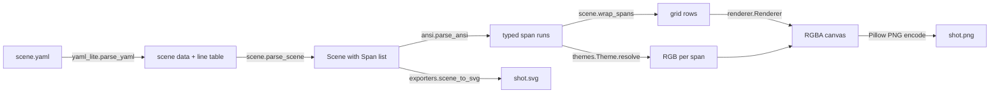

# terminal-snap

**Write a terminal screenshot as a YAML file, render it as a pixel-perfect PNG in pure Python.** No browser, no headless Chrome, no ffmpeg, no external binary — just Pillow.

[](https://github.com/kele-tao/terminal-snap/actions/workflows/ci.yml)




*A real render of `terminal-snap gallery examples --out docs/gallery` — every panel is a PNG this tool produced from a committed scene file.*

## The problem

Every README wants a terminal screenshot. The options are all bad:

- **Take a screenshot by hand.** It goes stale the moment the CLI changes, it is impossible to review in a pull request, and on a HiDPI laptop it comes out blurry or 4 MB large.
- **Use an online generator (carbon, ray.so, codeimg).** The image lives on someone else's server, carries their watermark, needs a network round-trip, and cannot be regenerated in CI.
- **Use a browser-based one (termshot, svg-term, asciinema → svg).** Now your docs build needs Chromium: 300 MB of dependency to draw 20 lines of monospace text.

The screenshot in your README *is* documentation. It should be versioned, reviewable, reproducible and generated by a command, exactly like every other artifact you ship. terminal-snap makes it that: a scene is a small YAML file, and `terminal-snap render` turns it into a deterministic PNG.

## What it does

- **Scriptable scenes.** YAML (or JSON) with `title`, `theme`, `width`, `chrome`, `padding`, `prompt`, `line_numbers`, `caption`, `wrap` and a list of styled lines. Invalid scenes are rejected with **every** problem reported, each with its line number.
- **Pure-Python rendering.** A fixed character grid drawn with Pillow at 2x (or 1x-8x). Box drawing, tables and progress bars line up because every cell is one measured advance wide.
- **Real ANSI.** 16-colour, 256-colour and 24-bit truecolor SGR parsing, plus bold, dim, italic, underline, reverse and strike. Carriage returns, backspaces and tabs are interpreted the way a terminal interprets them, so a captured progress bar renders as its final state instead of garbage.
- **`record` for honesty.** `terminal-snap record --cmd "pytest -q"` runs your command, captures stdout+stderr with ANSI preserved, and writes a scene file you can commit. The screenshot can never drift from the real output.
- **Eight built-in themes** (dracula, nord, gruvbox, github-dark, solarized-dark, solarized-light, catppuccin-mocha, tokyo-night) as JSON data files, plus `--theme path/to/custom.json` for your own.
- **Glyph fallback.** When the monospace font lacks a CJK or emoji glyph, a second font is used for just those cells instead of drawing a tofu box.
- **Window chrome** in macOS, Windows and plain styles, an optional caption bar, an optional line-number gutter and a soft drop shadow.
- **Vector and web output.** `--svg` writes real SVG text; `--html` writes a self-contained page with the PNG inlined as base64.
- **Validation with line numbers.** `terminal-snap validate scene.yaml` reports every error at once, like a compiler.
- **Deterministic.** Same scene + same font + same Pillow version = byte-identical PNG, so CI can assert it.
- **Zero network, zero telemetry.** One dependency: Pillow.

## Install

terminal-snap is **not on PyPI yet** — install it from source:

```bash
git clone https://github.com/kele-tao/terminal-snap
cd terminal-snap
python -m pip install -e .
```

For the test suite and linter:

```bash
python -m pip install -e ".[dev]"
```

Python 3.10, 3.11 and 3.12 are supported and tested in CI. The only runtime dependency is **Pillow >= 9** (rasterisation and TrueType loading). Everything else — YAML parsing, ANSI parsing, SVG output, the CLI — is standard library.

## Usage

### 1. Render a scene

```bash
$ terminal-snap render examples/pytest.yaml --out docs/pytest.png --json
{
  "scene": "examples/pytest.yaml",
  "out": "docs/pytest.png",
  "width": 1904,
  "height": 854,
  "columns": 100,
  "rows": 14,
  "bytes": 90415,
  "theme": "nord",
  "font": "Cascadia Mono",
  "wrapped_rows": 0,
  "warnings": []
}
```

The scene behind it is a 14-line YAML file — a real pytest failure captured with `record`:

```yaml
title: pytest -q
theme: nord
width: 100
chrome: macos
prompt: "❯"
lines:
  - cmd: python -m pytest examples/demo_tests -q --color=yes -p no:asyncio
  - out: "\x1b[32m..\x1b[0m\x1b[31mF\x1b[0m\x1b[32m...\x1b[0m"
  # ...
```

### 2. Record real output

```bash
$ terminal-snap record --cmd "python examples/ansi_demo.py" \
      --out examples/ansi.yaml --title "examples/ansi_demo.py" --theme dracula
recorded 17 lines from 'python examples/ansi_demo.py' (exit 0, 94 ms) -> examples/ansi.yaml

$ terminal-snap render examples/ansi.yaml --out docs/gallery/ansi.png
rendered docs/gallery/ansi.png  1760x1050 px  (71 KB, theme dracula, font Cascadia Mono)
```

`record` keeps the ANSI escapes, so colours survive the round trip. Re-rendering a captured scene cannot invent output that never happened.

### 3. Validate before you commit

```bash
$ terminal-snap validate examples/invalid/broken.yaml
error  broken.yaml:4  theme: unknown theme 'draculaa'; built-in themes: catppuccin-mocha, dracula, github-dark, gruvbox, nord, solarized-dark, solarized-light, tokyo-night
error  broken.yaml:5  width: must be between 20 and 400
error  broken.yaml:6  colour: unknown field; valid fields: caption, chrome, cursor, font, font_size, line_numbers, lines, padding, prompt, scale, shadow, tab_width, theme, title, width, wrap
error  broken.yaml:9  lines[1]: expected one of: text, cmd, out, notice, blank
error  broken.yaml:10  lines[2].text: expected a string
error  broken.yaml:11  lines[3].delay: must be between 0 and 60000
error  broken.yaml:14  lines[5].fg: expected a hex colour like #ff79c6
7 problem(s) found
$ echo $?
1
```

### 4. Discover themes and fonts

```bash
$ terminal-snap themes
8 built-in themes:
  catppuccin-mocha  Catppuccin Mocha    #1e1e2e
  dracula           Dracula             #282a36
  github-dark       GitHub Dark         #0d1117
  gruvbox           Gruvbox Dark        #282828
  nord              Nord                #2e3440
  solarized-dark    Solarized Dark      #002b36
  solarized-light   Solarized Light     #fdf6e3
  tokyo-night       Tokyo Night         #1a1b26

$ terminal-snap fonts
default: Cascadia Mono (C:\WINDOWS\Fonts\CascadiaMono.ttf)
 * Cascadia Mono       C:\WINDOWS\Fonts\CascadiaMono.ttf
   Cascadia Code       C:\WINDOWS\Fonts\CascadiaCode.ttf
   Consolas            C:\WINDOWS\Fonts\consola.ttf
   Courier New         C:\WINDOWS\Fonts\cour.ttf
   Lucida Console      C:\WINDOWS\Fonts\lucon.ttf
```

### 5. Render a whole gallery

```bash
$ terminal-snap gallery examples --out docs/gallery --html docs/gallery.html
docs\gallery\ansi.png  1760x1050  71 KB
docs\gallery\fonts.png  1616x511  63 KB
docs\gallery\pytest.png  1904x854  88 KB
docs\gallery\themes.png  1256x1050  101 KB
docs\gallery\traceback.png  1508x1182  123 KB
docs\gallery\validate.png  1688x805  110 KB
wrote docs/gallery.html  (6 cards)
```

### Exit codes

| Code | Meaning |
| --- | --- |
| 0 | Success. |
| 1 | The command ran but a quality gate failed: `validate` found problems, or `render --fail-on-warning` hit a missing glyph. |
| 2 | Usage error: unknown flag, missing file, malformed scene, unknown theme or font. |

## How it works



**Parsing.** `yaml_lite` is a small block-YAML parser written for this project. It returns both the data and a `path -> line number` table, which is what powers errors like "line 14: lines[5].fg: expected a hex colour". Anchors, tags and multi-document streams are rejected explicitly rather than silently mis-parsed, because a docs tool that quietly produces the wrong picture is worse than one that fails.

**Layout.** A scene is flattened into styled spans (two immutable dataclasses: `Style` and `Span`). Wrapping happens at the span level, so a hard-wrapped line keeps its colours across the break. The renderer measures the font's advance width once and treats the page as a character grid, so the pixel position of column *n* is exactly `n * advance`. That is why tables drawn with box-drawing characters line up with no manual alignment.

**Drawing.** Each row is drawn as runs of text sharing one resolved style. Colour resolution goes through the theme: palette index → theme RGB, 256-colour → xterm cube, truecolor → as-is, with `dim` blended toward the background and `reverse` swapping foreground and background. Glyphs the primary font cannot draw are looked up in a fallback font (CJK, symbol, emoji) and drawn from there.

## Design decisions

**1. Pillow instead of a terminal emulator or a browser.** The alternative designs are (a) drive a real terminal and screenshot it, or (b) render HTML in Chromium. Both are nondeterministic across machines and both add hundreds of megabytes of dependency. Drawing directly gives exact control over metrics, keeps the tool installable with one `pip install`, and makes byte-identical output achievable. The cost is that ANSI parsing and text shaping are ours to implement — about 300 lines of parser plus 90 tests.

**2. A small YAML parser instead of PyYAML.** Scenes need maybe 15% of YAML: nested maps, lists, quoted strings, block scalars. PyYAML would double the dependency count for that. The custom parser is also better here in one specific way: PyYAML gives a line number but no domain context, while ours keeps a path table so errors read `lines[5].fg: expected a hex colour`. The cost is that advanced YAML (anchors, tags, multi-document) is not supported — and rather than half-supporting it, it is rejected with a clear message.

**3. Two font sizes, one grid.** The chrome title and caption use a smaller font than the body. They are drawn with the same measured advance and clamped to the grid, so the window frame and the content line up. The tradeoff: very small chrome text can look slightly loose, and a second grid would fix that at the cost of a much more complex layout model.

**Also deliberate:** `record` merges stderr into stdout at the OS level (`stderr=STDOUT`) rather than concatenating two buffers, because the ordering inside a test report is part of what you are documenting. `--max-lines` elides the middle symmetrically rather than truncating the tail, because tracebacks carry signal at both ends.

## Performance

Measured with `python benchmarks/run.py` on Python 3.12.10 / Windows 11, median of 3-5 runs. Full table in [benchmarks/results.md](benchmarks/results.md).

| Case | Time |
| --- | --- |
| parse scene (1,000 lines) | 16 ms |
| parse scene (20,000 lines) | 271 ms |
| parse ANSI log (1.0 MB) | 136 ms |
| parse ANSI log (5.0 MB) | 1.12 s |
| rasterise 40 rows @2x (1976×2128 px) | 156 ms |
| rasterise 40 rows @3x (2860×3173 px) | 331 ms |
| render + PNG encode 40 rows (287 KB PNG) | 501 ms |
| render the bundled 6-scene gallery | 1.22 s |

The 5 MB ANSI case exists because that is the size of a log someone might want to turn into a screenshot. Before memoising `(style, sequence)` pairs it took 3.7 s on the same input; after the memo table and the control-character fast path it is ~1.1 s. Wall times move by ±20% with background load, which is why the committed `results.md` is the number to trust rather than this table.

## Comparison

| | terminal-snap | carbon / ray.so | svg-term / termtosvg | asciinema |
| --- | --- | --- | --- | --- |
| Runs offline | yes | no (CDN) | yes | yes |
| Deterministic output | yes | no | mostly | no (timing) |
| Scriptable, diffable scenes | yes (YAML) | no (paste text) | no (record a session) | no |
| Output formats | PNG + SVG + HTML | PNG / SVG | SVG | asciinema cast |
| Needs a browser or a terminal | no | browser | terminal to record | terminal |
| Themes | 8 built-in + custom JSON | many presets | few | terminal's own |
| Animations | no | no | yes (typed) | yes |
| Best at | committed docs screenshots | quick one-off images | animated SVG demos | shareable recordings |

Honest summary: for a one-off image, pasting text into ray.so is still faster. For an animated demo, asciinema is the right tool. terminal-snap is for screenshots that live in your repository and have to stay true.

## Roadmap

- **Scene inheritance.** `extends: base.yaml` so a docs set can share one theme block.
- **Image diffing.** `terminal-snap diff old.png new.png` with a perceptual metric, wired into CI so a scene change that alters pixels fails the build.
- **Native ligatures.** Draw programming ligatures from fonts that support them (`->`, `!=`); today each character is drawn on its own grid cell.
- **Scene variables.** `{{ version }}` substitution from the environment or a JSON file, so release screenshots need no hand-editing.
- **More output formats.** WebP, plus an `@2x` filename convention for GitHub's retina rendering.

Cut from v1.0 and recorded here rather than faked: animated output (typing animation, animated SVG frames), a font bundling/downloading story, and Windows console colour detection beyond `FORCE_COLOR`/`NO_COLOR`.

## Contributing

Issues and pull requests are welcome. Run the full local suite before opening a PR:

```bash
python -m pip install -e ".[dev]"
python -m ruff check .
python -m pytest -q
python benchmarks/run.py --quick
```

See [CONTRIBUTING.md](CONTRIBUTING.md) for the code layout and the review checklist. Security reports: [SECURITY.md](SECURITY.md).

## License

MIT — see [LICENSE](LICENSE).
