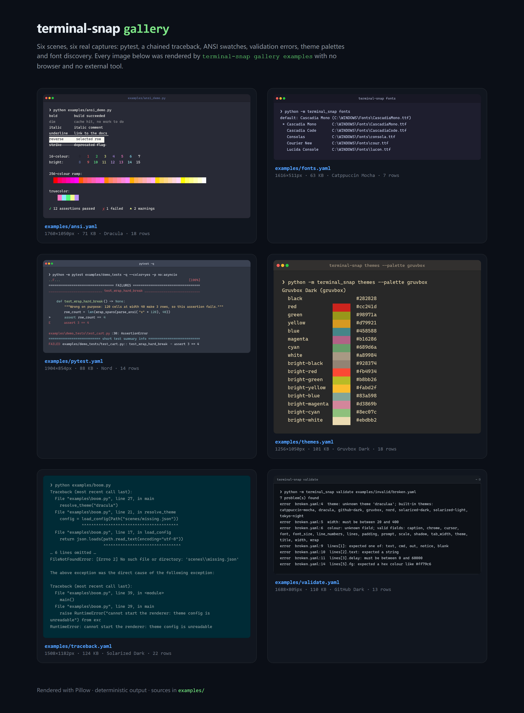
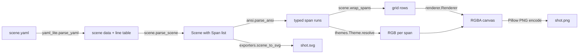

# terminal-snap

[English](README.md) | **简体中文**

**把终端截图写成一个 YAML 文件，再用纯 Python 渲染成像素级精确的 PNG。** 不需要浏览器，不需要 headless Chrome，不需要 ffmpeg，也不需要任何外部二进制——只要有 Pillow。

[](https://github.com/kele-tao/terminal-snap/actions/workflows/ci.yml)




*这是 `terminal-snap gallery examples --out docs/gallery` 的真实渲染结果——每一块面板都是本工具从已提交的场景文件生成的 PNG。*

## 问题

每个 README 都想要一张终端截图，而现成的选项都不怎么样：

- **手动截图。** CLI 一改它就过时，在 pull request 里没法评审；在 HiDPI 笔记本上，它不是糊掉就是变成 4 MB 的大图。
- **用在线生成器（carbon、ray.so、codeimg）。** 图片存在别人的服务器上，带着别人的水印，每次都要走一趟网络，而且没法在 CI 里重新生成。
- **用基于浏览器的方案（termshot、svg-term、asciinema → svg）。** 这下你的文档构建要依赖 Chromium 了：为了画 20 行等宽文本，得背上 300 MB 的依赖。

README 里的截图*就是*文档。它应该像你交付的其他产物一样：纳入版本控制、可以评审、可以复现，并且由一条命令生成。terminal-snap 做的正是这件事——一个场景就是一个很小的 YAML 文件，`terminal-snap render` 把它变成一张确定性的 PNG。

## 它能做什么

- **可脚本化的场景。** YAML（或 JSON），字段包括 `title`、`theme`、`width`、`chrome`、`padding`、`prompt`、`line_numbers`、`caption`、`wrap`，以及一组带样式的行。非法场景会被拒绝，并报出**每一个**问题，每条都带行号。
- **纯 Python 渲染。** 用 Pillow 在 2x（或 1x-8x）下绘制固定字符网格。框线、表格和进度条之所以能对齐，是因为每个单元格都恰好是一个实测步进（advance）宽。
- **真正的 ANSI。** 支持 16 色、256 色和 24 位真彩的 SGR 解析，以及粗体、暗色（dim）、斜体、下划线、反显和删除线。回车符、退格符和制表符按终端的方式解释，因此捕获到的进度条渲染出来是它的最终状态，而不是一堆乱码。
- **`record` 保证诚实。** `terminal-snap record --cmd "pytest -q"` 会运行你的命令，保留 ANSI 捕获 stdout 与 stderr，并写出一个可以提交的场景文件。这样一来，截图永远不会偏离真实输出。
- **八套内置主题**（dracula、nord、gruvbox、github-dark、solarized-dark、solarized-light、catppuccin-mocha、tokyo-night），以 JSON 数据文件形式提供；也可以用 `--theme path/to/custom.json` 指定自己的主题。
- **字形回退。** 当等宽字体缺少某个中日韩（CJK）或 emoji 字形时，只用第二款字体绘制这些单元格，而不是画一个豆腐块。
- **窗口外框** 提供 macOS、Windows 和 plain 三种风格，另有可选的标题栏（caption）、可选的行号栏和柔和投影。
- **矢量与网页输出。** `--svg` 写出真正的 SVG 文本；`--html` 写出一个自包含页面，把 PNG 以 base64 内联进去。
- **带行号的校验。** `terminal-snap validate scene.yaml` 像编译器一样，一次性报出所有错误。
- **确定性。** 相同场景 + 相同字体 + 相同 Pillow 版本 = 逐字节相同的 PNG，所以 CI 可以据此断言。
- **零网络、零遥测。** 只有一个依赖：Pillow。

## 安装

terminal-snap **还没有发布到 PyPI**——从源码安装：

```bash
git clone https://github.com/kele-tao/terminal-snap
cd terminal-snap
python -m pip install -e .
```

如果还要跑测试套件和静态检查：

```bash
python -m pip install -e ".[dev]"
```

CI 中支持的 Python 版本为 3.10、3.11 和 3.12，并已实际测试。唯一的运行时依赖是 **Pillow >= 9**（用于光栅化和加载 TrueType 字体）。其余部分——YAML 解析、ANSI 解析、SVG 输出、CLI——全部来自标准库。

## 用法

### 1. 渲染一个场景

```bash
$ terminal-snap render examples/pytest.yaml --out docs/pytest.png --json
{
  "scene": "examples/pytest.yaml",
  "out": "docs/pytest.png",
  "width": 1904,
  "height": 854,
  "columns": 100,
  "rows": 14,
  "bytes": 90415,
  "theme": "nord",
  "font": "Cascadia Mono",
  "wrapped_rows": 0,
  "warnings": []
}
```

它背后的场景是一个 14 行的 YAML 文件——一次用 `record` 捕获的真实 pytest 失败：

```yaml
title: pytest -q
theme: nord
width: 100
chrome: macos
prompt: "❯"
lines:
  - cmd: python -m pytest examples/demo_tests -q --color=yes -p no:asyncio
  - out: "\x1b[32m..\x1b[0m\x1b[31mF\x1b[0m\x1b[32m...\x1b[0m"
  # ...
```

### 2. 录制真实输出

```bash
$ terminal-snap record --cmd "python examples/ansi_demo.py" \
      --out examples/ansi.yaml --title "examples/ansi_demo.py" --theme dracula
recorded 17 lines from 'python examples/ansi_demo.py' (exit 0, 94 ms) -> examples/ansi.yaml

$ terminal-snap render examples/ansi.yaml --out docs/gallery/ansi.png
rendered docs/gallery/ansi.png  1760x1050 px  (71 KB, theme dracula, font Cascadia Mono)
```

`record` 会保留 ANSI 转义序列，所以颜色能完整走完这一圈。重新渲染捕获来的场景，不可能凭空造出从未发生过的输出。

### 3. 提交之前先校验

```bash
$ terminal-snap validate examples/invalid/broken.yaml
error  broken.yaml:4  theme: unknown theme 'draculaa'; built-in themes: catppuccin-mocha, dracula, github-dark, gruvbox, nord, solarized-dark, solarized-light, tokyo-night
error  broken.yaml:5  width: must be between 20 and 400
error  broken.yaml:6  colour: unknown field; valid fields: caption, chrome, cursor, font, font_size, line_numbers, lines, padding, prompt, scale, shadow, tab_width, theme, title, width, wrap
error  broken.yaml:9  lines[1]: expected one of: text, cmd, out, notice, blank
error  broken.yaml:10  lines[2].text: expected a string
error  broken.yaml:11  lines[3].delay: must be between 0 and 60000
error  broken.yaml:14  lines[5].fg: expected a hex colour like #ff79c6
7 problem(s) found
$ echo $?
1
```

### 4. 查看可用的主题与字体

```bash
$ terminal-snap themes
8 built-in themes:
  catppuccin-mocha  Catppuccin Mocha    #1e1e2e
  dracula           Dracula             #282a36
  github-dark       GitHub Dark         #0d1117
  gruvbox           Gruvbox Dark        #282828
  nord              Nord                #2e3440
  solarized-dark    Solarized Dark      #002b36
  solarized-light   Solarized Light     #fdf6e3
  tokyo-night       Tokyo Night         #1a1b26

$ terminal-snap fonts
default: Cascadia Mono (C:\WINDOWS\Fonts\CascadiaMono.ttf)
 * Cascadia Mono       C:\WINDOWS\Fonts\CascadiaMono.ttf
   Cascadia Code       C:\WINDOWS\Fonts\CascadiaCode.ttf
   Consolas            C:\WINDOWS\Fonts\consola.ttf
   Courier New         C:\WINDOWS\Fonts\cour.ttf
   Lucida Console      C:\WINDOWS\Fonts\lucon.ttf
```

### 5. 渲染整个画廊

```bash
$ terminal-snap gallery examples --out docs/gallery --html docs/gallery.html
docs\gallery\ansi.png  1760x1050  71 KB
docs\gallery\fonts.png  1616x511  63 KB
docs\gallery\pytest.png  1904x854  88 KB
docs\gallery\themes.png  1256x1050  101 KB
docs\gallery\traceback.png  1508x1182  123 KB
docs\gallery\validate.png  1688x805  110 KB
wrote docs/gallery.html  (6 cards)
```

### 退出码

| 退出码 | 含义 |
| --- | --- |
| 0 | 成功。 |
| 1 | 命令跑完了，但质量门禁未通过：`validate` 发现问题，或 `render --fail-on-warning` 遇到缺失字形。 |
| 2 | 用法错误：未知参数、文件缺失、场景格式错误、未知主题或字体。 |

## 工作原理



**解析。** `yaml_lite` 是为本项目编写的小型块式 YAML 解析器。它同时返回数据和一张 `path -> 行号` 映射表，正是这张表撑起了 `line 14: lines[5].fg: expected a hex colour` 这类报错。锚点、标签和多文档流会被明确拒绝，而不是悄悄解析错——一个安静地画出错误图片的文档工具，比一个直接失败的工具更糟糕。

**布局。** 场景会被摊平成一串带样式的 span（两个不可变数据类：`Style` 和 `Span`）。换行发生在 span 层，所以硬折行的一行在断行处两侧都能保住颜色。渲染器只测量一次字体的步进宽度，然后把整页当成字符网格处理，于是第 *n* 列的像素位置恰好是 `n * advance`。这就是为什么用框线字符画出的表格不需要手工对齐也能对齐。

**绘制。** 每一行按共享同一个已解析样式的文本片段（run）来绘制。颜色解析走主题：调色板索引 → 主题 RGB，256 色 → xterm 色立方，真彩 → 原样使用；同时 `dim` 会向背景混合，`reverse` 会交换前景与背景。主字体画不出来的字形会到回退字体（CJK、符号、emoji）里查找，再用那款字体绘制。

## 设计取舍

**1. 用 Pillow，而不是终端模拟器或浏览器。** 备选设计是（a）驱动一个真实终端再截屏，或者（b）在 Chromium 里渲染 HTML。两者在不同机器上都不确定，而且都要引入几百 MB 的依赖。直接绘制可以对字符度量做精确控制，让工具保持一条 `pip install` 就能装好，并让逐字节一致的输出成为可能。代价是 ANSI 解析和文本塑形得由我们自己实现——大约 300 行解析器，加上 90 个测试。

**2. 自己写小型 YAML 解析器，而不是用 PyYAML。** 场景大概只用到 YAML 的 15%：嵌套映射、列表、带引号的字符串、块标量。为这点功能引入 PyYAML 会让依赖数量翻倍。自研解析器在一个具体方面也更好：PyYAML 只给行号、不给领域上下文，而我们的解析器保留了路径表，所以错误能写成 `lines[5].fg: expected a hex colour`。代价是不支持高级 YAML（锚点、标签、多文档）——与其半支持，不如明确拒绝并给出清晰的提示。

**3. 两种字号，一套网格。** 外框标题和标题栏用的是比正文更小的字号。它们用同一个实测步进绘制，并被夹到网格上，所以窗口边框和内容是对齐的。取舍在于：很小的外框文字可能显得略微松散，再引入一套网格能解决这个问题，但会让布局模型复杂得多。

**另外还有意为之的地方：** `record` 在操作系统层面把 stderr 并进 stdout（`stderr=STDOUT`），而不是拼接两个缓冲区，因为测试报告内部的顺序本身就是你在记录的内容之一。`--max-lines` 对称地省略中间部分，而不是截掉尾部，因为 traceback 的两端都携带信息。

## 性能

用 `python benchmarks/run.py` 在 Python 3.12.10 / Windows 11 上测量，取 3-5 次运行的中位数。完整表格见 [benchmarks/results.md](benchmarks/results.md)。

| 场景 | 耗时 |
| --- | --- |
| 解析场景（1,000 行） | 16 ms |
| 解析场景（20,000 行） | 271 ms |
| 解析 ANSI 日志（1.0 MB） | 136 ms |
| 解析 ANSI 日志（5.0 MB） | 1.12 s |
| 光栅化 40 行 @2x（1976×2128 px） | 156 ms |
| 光栅化 40 行 @3x（2860×3173 px） | 331 ms |
| 渲染 + PNG 编码 40 行（287 KB PNG） | 501 ms |
| 渲染内置的 6 场景画廊 | 1.22 s |

5 MB 这个 ANSI 用例之所以存在，是因为这可能正是某个人想转成截图的日志体量。在给 `(style, sequence)` 对做记忆化之前，同样的输入要 3.7 s；加上记忆表和不可打印字符快路径之后，大约是 1.1 s。实际耗时随后台负载有 ±20% 的浮动，所以该相信的是仓库里提交的 `results.md`，而不是这张表。

## 对比

| | terminal-snap | carbon / ray.so | svg-term / termtosvg | asciinema |
| --- | --- | --- | --- | --- |
| 是否离线运行 | 是 | 否（CDN） | 是 | 是 |
| 输出是否确定 | 是 | 否 | 大体上是 | 否（依赖时序） |
| 场景可脚本化、可 diff | 是（YAML） | 否（粘贴文本） | 否（录制会话） | 否 |
| 输出格式 | PNG + SVG + HTML | PNG / SVG | SVG | asciinema cast |
| 是否需要浏览器或终端 | 否 | 浏览器 | 录制时需要终端 | 终端 |
| 主题 | 8 套内置 + 自定义 JSON | 大量预设 | 少量 | 终端自带 |
| 动画 | 否 | 否 | 是（逐字打出） | 是 |
| 最擅长 | 提交进仓库的文档截图 | 快速生成一次性图片 | 动画 SVG 演示 | 可分享的录屏 |

诚实的总结：如果只是要一张一次性图片，把文本粘进 ray.so 仍然更快。如果要做动画演示，asciinema 才是合适的工具。terminal-snap 面向的是那些放进仓库、并且必须保持真实的截图。

## 路线图

- **场景继承。** `extends: base.yaml`，让一套文档可以共享同一个主题块。
- **图片 diff。** `terminal-snap diff old.png new.png`，带感知度量指标，并接入 CI，使得改变像素的场景变更会让构建失败。
- **原生连字。** 从支持连字的字体里绘制编程连字（`->`、`!=`）；目前每个字符都画在自己的网格单元里。
- **场景变量。** 从环境变量或 JSON 文件做 `{{ version }}` 替换，这样发布截图无需手工修改。
- **更多输出格式。** WebP，以及为 GitHub 的 retina 渲染提供 `@2x` 文件名约定。

从 v1.0 中砍掉、并如实记录在这里而不是假装已经实现：动画输出（打字动画、动态 SVG 帧）、字体打包/下载方案，以及 `FORCE_COLOR`/`NO_COLOR` 之外的 Windows 控制台颜色检测。

## 参与贡献

Issues 和 pull request 都欢迎。开 PR 之前，先跑一遍完整的本地测试：

```bash
python -m pip install -e ".[dev]"
python -m ruff check .
python -m pytest -q
python benchmarks/run.py --quick
```

代码布局和评审清单见 [CONTRIBUTING.md](CONTRIBUTING.md)。安全问题报告见 [SECURITY.md](SECURITY.md)。

## 许可证

MIT——见 [LICENSE](LICENSE)。