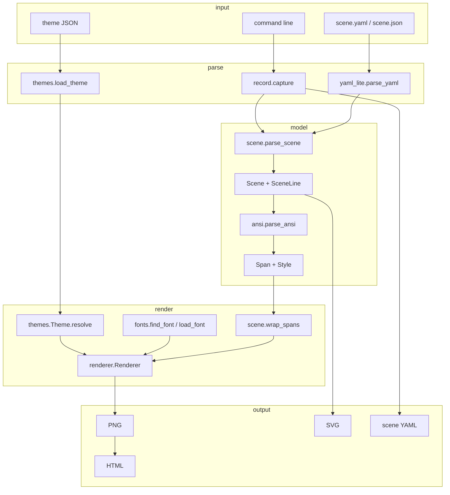

# Architecture

terminal-snap is a pipeline of six small modules. Each one has one job and can be
tested without the others, which is what keeps a 3,000-line image tool debuggable.

## Data flow in detail

1. **`yaml_lite.parse_yaml`** returns a `Document` containing both the
   parsed tree and a `dict[(path), line_number]`. The line table is the only reason
   validation errors can say `lines[5].fg` instead of `key 'fg'`.
2. **`scene.parse_scene`** validates the tree against the schema and builds a
   `Scene`. It never raises on the first problem: it collects a `Problem` for
   each one, sorts them by line, and returns them all. The CLI decides the exit code.
3. **`ansi.parse_ansi`** turns one raw line into a tuple of `Span`s. Each
   `Span` is `(text, Style)` where `Style` holds colour references
   (`ColorRef(index)` or `ColorRef(rgb=...)`), not resolved RGB — resolution
   happens later, once the theme is known.
4. **`scene.wrap_spans`** wraps at a cell width, keeping styles intact across the
   break and preferring spaces over hard splits.
5. **`renderer.Renderer`** measures the font advance once, computes geometry, and
   draws each row as runs of same-styled text. Glyph lookups are cached per character.
6. **Exporters** re-use the same model: `scene_to_svg` re-runs the layout and emits
   `<text>` elements; `scene_to_html` inlines the PNG as base64.

## Why the model is split this way

The ANSI layer knows nothing about themes, and the theme layer knows nothing about
text layout. That separation is what lets `terminal-snap validate` check a scene
without loading any font or touching Pillow, and what lets the SVG exporter work on a
machine where the PNG fonts are missing.

## Determinism

Three things would normally break byte-identical output, and each is handled:

| Risk | Handling |
| --- | --- |
| Font rendering differences | The advance width is measured, not assumed; all positions are integer multiples of it. |
| Anti-aliasing jitter | Pillow's rasteriser is deterministic for a given font file and size. |
| Metadata in PNG | `Image.save(..., optimize=True)` with no `pnginfo`, so no timestamps are written. |

What is *not* guaranteed: the same scene on a different machine with a different font
installed will differ, because the font is part of the input. `terminal-snap fonts`
exists so you can see exactly which file was used.
