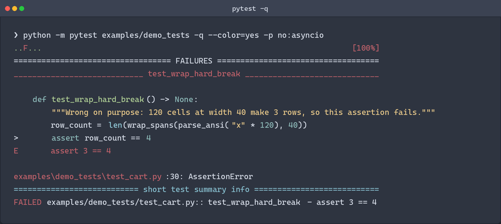
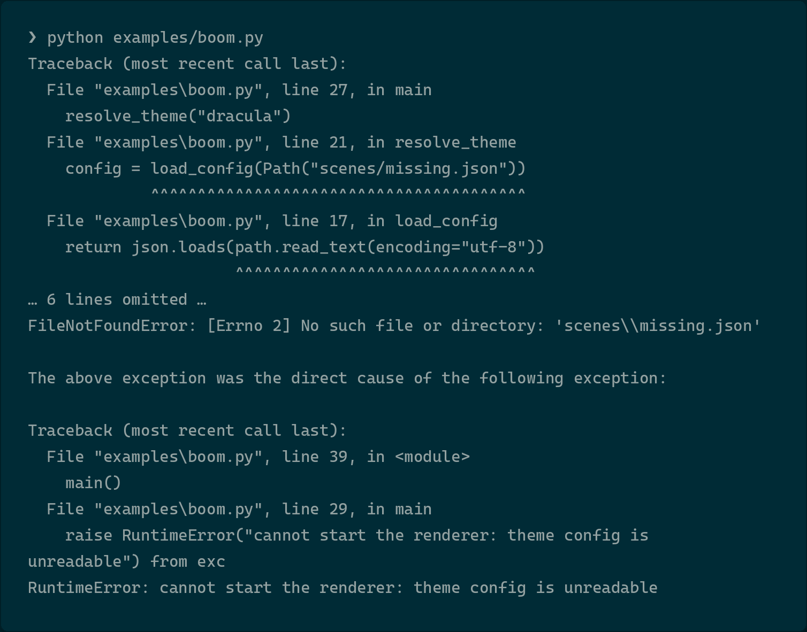
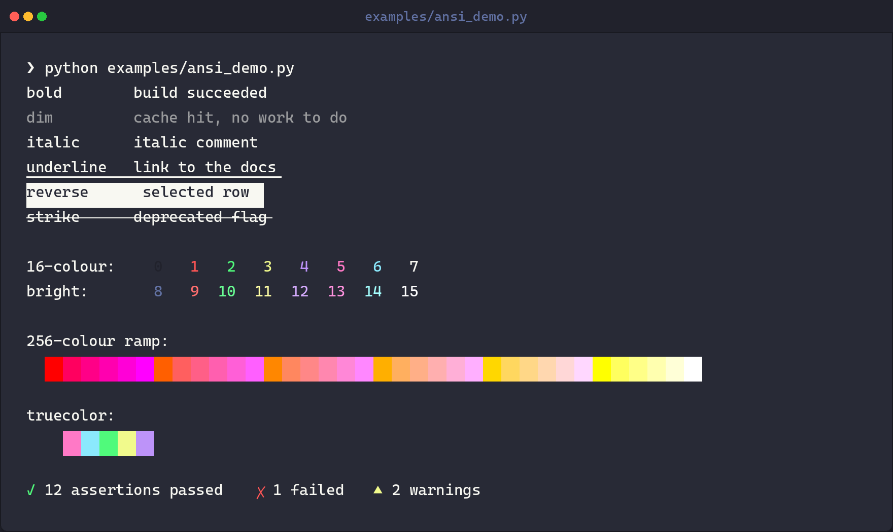
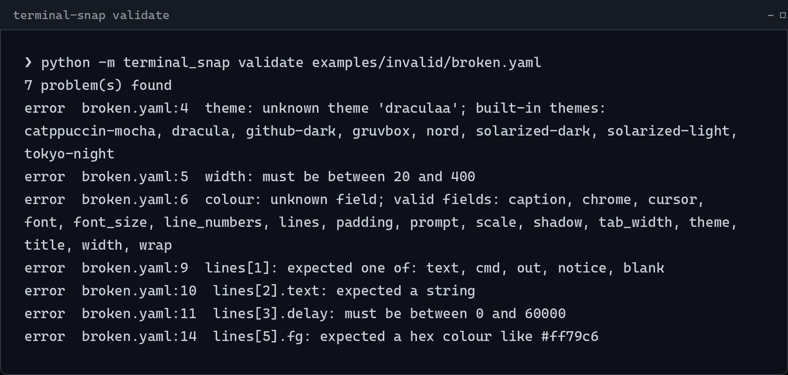
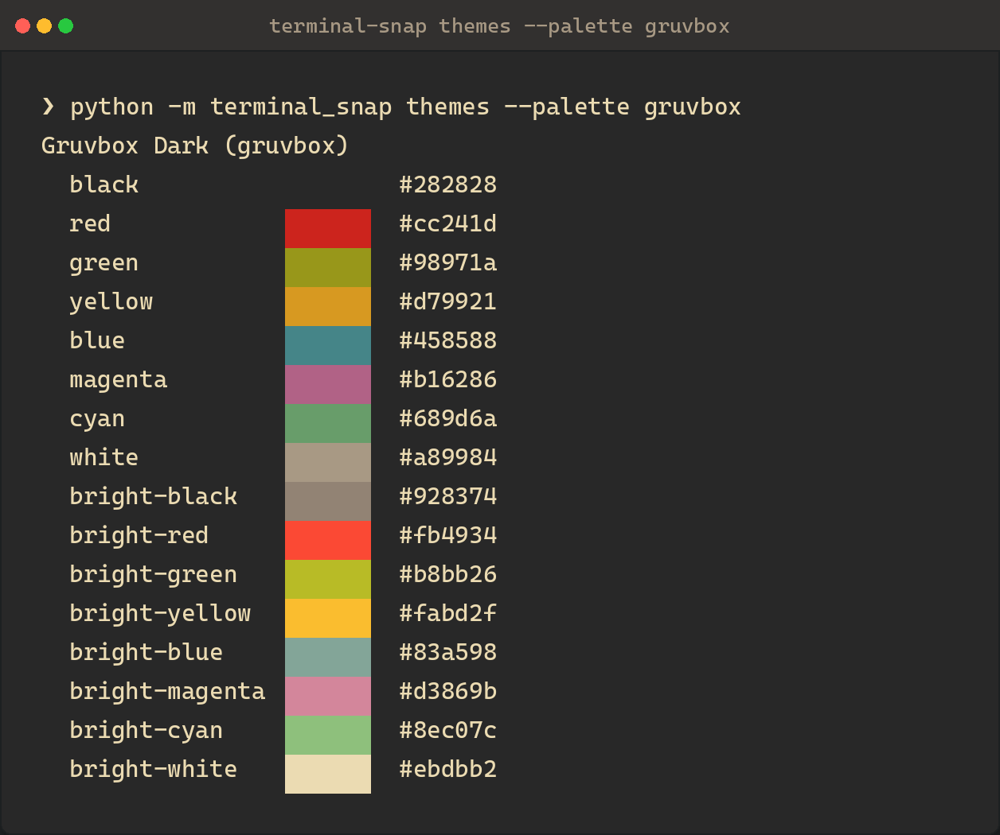
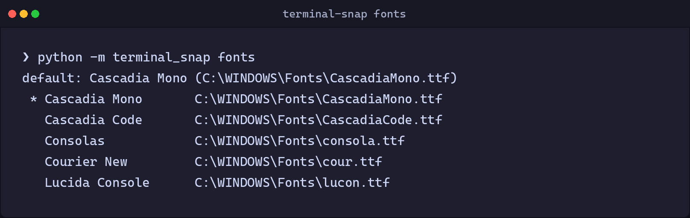

# Gallery

Six scenes, six real renders. Every image here was produced by one command from a
committed scene file — no hand-written HTML, no browser, no post-processing:

```bash
python -m terminal_snap gallery examples --out docs/gallery --html docs/gallery.html
```

| Scene | What it demonstrates | Render |
| --- | --- | --- |
| [examples/pytest.yaml](../examples/pytest.yaml) | A real pytest failure captured with `record`: 256-colour ANSI, red/green diff colouring, box-drawing separators. |  |
| [examples/traceback.yaml](../examples/traceback.yaml) | A real chained Python traceback, plain chrome, Solarized Dark. The elided middle is marked by `… 6 lines omitted …`. |  |
| [examples/ansi.yaml](../examples/ansi.yaml) | Every ANSI feature the renderer supports: attributes, the 16-colour wheel, a 36-swatch 256-colour ramp and truecolor blocks. |  |
| [examples/validate.yaml](../examples/validate.yaml) | Compiler-style validation errors captured from `terminal-snap validate`, with GitHub Dark chrome. |  |
| [examples/themes.yaml](../examples/themes.yaml) | `terminal-snap themes --palette gruvbox` rendered in the theme it is describing. |  |
| [examples/fonts.yaml](../examples/fonts.yaml) | Monospace font discovery on the machine that produced this gallery. |  |

## How each scene was made

Three of the six are captured, not authored:

```bash
terminal-snap record --cmd "python -m pytest examples/demo_tests -q --color=yes -p no:asyncio" \
    --out examples/pytest.yaml --title "pytest -q" --theme nord --width 100 --max-lines 20

terminal-snap record --cmd "python examples/boom.py" \
    --out examples/traceback.yaml --title "python examples/boom.py fails" \
    --theme solarized-dark --width 78 --chrome plain --max-lines 20

terminal-snap record --cmd "python -m terminal_snap validate examples/invalid/broken.yaml" \
    --out examples/validate.yaml --title "terminal-snap validate" \
    --theme github-dark --width 88 --chrome windows --max-lines 22
```

The other three (`ansi.yaml`, `themes.yaml`, `fonts.yaml`) are the same
`record` command applied to the tool's own ANSI demo script and its own
`themes` / `fonts` subcommands, so even the demo of the demo is real output.

## Regenerating

```bash
python -m terminal_snap gallery examples --out docs/gallery --html docs/gallery.html
```

The PNGs are deterministic: re-running this on the same machine with the same font
and Pillow version reproduces them byte for byte. Font appearance varies by platform —
on Linux the same scenes will pick DejaVu Sans Mono and look slightly different, which
is expected and is why `examples/fonts.yaml` is part of the gallery.
